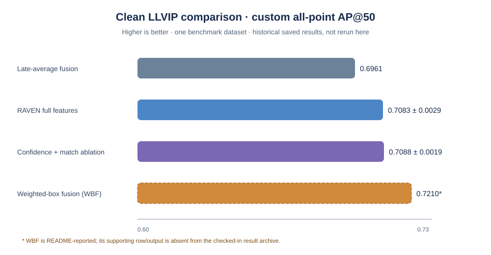

# RAVEN

**Risk-based arbitration for paired RGB–thermal pedestrian detection.**

RAVEN is a research prototype that studies whether a lightweight post-detection risk head can help select among detections from visible-light and thermal sensors. The research workflow uses paired images from the **LLVIP dataset** and frozen YOLOv8n detectors for the two modalities.

> **Research status:** exploratory prototype; LLVIP only. The saved archive does not yet fully reproduce all results described in the project summary. RAVEN is not safety-validated, its risk scores are not calibrated probabilities, and generalization to other datasets or real-world sensor failures has not been established.

## At a glance

- **Task:** pedestrian detection using paired visible-light RGB and thermal imagery.
- **Research workflow:** frozen per-modality detectors → candidate association → lightweight risk head → selection policy → evaluation.
- **Dataset:** LLVIP official train/test split; 3,463 test pairs are reported by the notebook.
- **Research notebook:** [`RAVEN.ipynb`](RAVEN.ipynb)
- **Reproducibility instructions:** [`docs/REPRODUCIBILITY.md`](docs/REPRODUCIBILITY.md)
- **Architecture:** [`docs/figures/raven_architecture.md`](docs/figures/raven_architecture.md)
- **Paper audit checklist:** [`docs/PAPER_AUDIT.md`](docs/PAPER_AUDIT.md)

## How the research method works

1. **Detect independently.** Run frozen YOLOv8n detectors on RGB and thermal images.
2. **Associate candidates.** Match detections across modalities and construct candidate/action features.
3. **Estimate action risk.** Train a lightweight head using annotation-derived targets; the detector backbones are not jointly trained by this head.
4. **Select outputs.** Evaluate arbitration choices such as joint, RGB-only, and thermal-only selection, with optional abstention.
5. **Evaluate on LLVIP.** Compare against baselines using the notebook's custom all-point AP@50 evaluator and its matching rule, alongside error and coverage measures.

This is a post-detection arbitration study, not a new object detector. See the architecture and reproducibility documents for implementation details and metric caveats.

## Research results and evidence status

The current project summary reports the following clean-test results:

| Method | Reported AP@50 / mAP@50 |
|---|---:|
| Late-average fusion | 0.6961 |
| RAVEN full model | 0.7083 ± 0.0029 |
| Confidence-plus-match ablation | 0.7088 ± 0.0019 |
| Weighted-box fusion (WBF) | 0.7210 |

**These figures are not yet fully traceable to the checked-in output archive.** The committed `output/RAVEN_LLVIP_2026-10-15/run_summary.json` is an older seed-42 run that records RAVEN AP50 0.7056, and its `table8_benchmark.csv` does not include the confidence-plus-match or WBF rows. The three-seed figures and WBF comparison should therefore be treated as reported project results, not independently verified archived results, until the matching notebook run and complete exports are saved.

Interpretation should remain conservative:

- WBF has the highest reported clean-test score in the project summary.
- The confidence-plus-match ablation is marginally above the full model, so the results do not establish that the learned geometry/risk features improve the score.
- The reported paired image-bootstrap interval for RAVEN versus late-average fusion is +0.0065 to +0.0187; image-level resampling does not account for scene clustering or all training uncertainty.
- Sensor-degradation tests use synthetic perturbations. They are not evidence of robustness to physical sensor failure, weather, glare, or deployment conditions.
- Coverage remained near 100% in the reported experiments, so meaningful selective risk reduction via abstention has not been demonstrated.

Do not compare these values as standard VOC mAP unless the evaluator is changed and all methods are recomputed consistently. The notebook uses a custom all-point AP@50 implementation with a specific one-to-one matching rule; see the [reproducibility guide](docs/REPRODUCIBILITY.md).

## Run the research notebook

The dataset is not included in this repository. Obtain LLVIP from its official source and follow the dataset terms.

1. Open [`RAVEN.ipynb`](RAVEN.ipynb) in Google Colab.
2. Select a GPU runtime if available.
3. Mount Google Drive when prompted and provide the LLVIP ZIP or extracted dataset directory.
4. Run the notebook cells from top to bottom; do not skip detection, candidate construction, training, evaluation, or export stages.
5. Check the dataset split and image-stem overlap checks, then save the notebook and all generated artifacts from the same run.

The notebook writes outputs under `/content/raven_results/`. Copy only outputs produced by the run being documented into a versioned repository output folder. Archive the configuration and runtime versions alongside each table.

Before using results in a paper, read [`docs/REPRODUCIBILITY.md`](docs/REPRODUCIBILITY.md) and [`docs/PAPER_AUDIT.md`](docs/PAPER_AUDIT.md). In particular, export the complete benchmark table, per-seed results, degradation summaries and bootstrap outputs from the exact run. Only include `pairing_summary.json` if the corresponding detector pairing was actually evaluated.

## Run the local application demo

The local demo is a separate software path from the LLVIP research notebook. Its outputs are **not** benchmark results and should not be used as evidence for the research tables.

### Requirements

- Python
- Node.js and npm
- Optional: Docker Desktop for the Compose setup

### Windows PowerShell

From the repository root:

```powershell
python -m venv .venv
.\.venv\Scripts\Activate.ps1
python -m pip install --upgrade pip
pip install -r requirements.txt

Push-Location frontend
npm ci
Pop-Location

python scripts/run_demo.py
```

Open the local URL printed by the launcher. Press `Ctrl+C` to stop it. The launcher creates a temporary local API key if `RAVEN_API_KEY` is not configured. To run the legacy Streamlit dashboard instead:

```powershell
python scripts/run_demo.py --legacy-streamlit
```

### Docker Compose

Copy `.env.example` to `.env`, replace all example secrets with private values, and run:

```powershell
docker compose up --build
```

Never commit `.env` or real credentials. PostgreSQL, Redis, and MinIO are optional for a larger deployment; the local application uses disk storage by default. Model weights may be downloaded by Ultralytics when required and are intentionally excluded from GitHub. The small app-side checkpoint at `data/models/confidence_fusion.pt` is an application artifact and is not proof of benchmark validation.

## Research scope and limitations

- **One dataset:** the current evaluation is LLVIP only. No KAIST or other independent-dataset result is established.
- **Frozen detectors:** the research workflow uses separate frozen RGB and thermal YOLOv8n detectors.
- **Custom metric:** AP@50 is calculated using the notebook's implementation and matching rule; it should not be presented as a standard evaluator result without qualification.
- **Synthetic degradation:** perturbations do not replicate the full range of real sensor failures or environmental conditions.
- **Risk and abstention:** risk outputs are not established as calibrated probabilities, and the reported coverage does not show useful abstention.
- **Baseline comparison:** WBF's reported clean score exceeds RAVEN's, and the confidence-plus-match ablation is marginally higher than the full model.
- **Archive completeness:** some outputs described in the project summary are missing or inconsistent with the currently checked-in run files. Resolve these discrepancies before final paper submission.

## Repository structure

```text
RAVEN/
├── RAVEN.ipynb                  # LLVIP research notebook
├── app.py                       # Streamlit compatibility entry point
├── configs/                     # Local application configuration
├── dashboard/                   # Streamlit interface
├── frontend/                    # Next.js interface
├── src/                          # API and application modules
├── scripts/                     # Launch and evaluation utilities
├── docs/
│   ├── REPRODUCIBILITY.md       # Dataset, environment, outputs and audit guidance
│   ├── PAPER_AUDIT.md           # Manuscript evidence checklist
│   └── figures/
│       └── raven_architecture.md
├── data/models/                 # Small local application checkpoint
└── output/RAVEN_LLVIP_2026-10-15/
    └── run_summary.json         # Older seed-42 run; see archive caveat above
```

## Contributors

Contributor roles are based on the current project allocation and should be confirmed by the team before publication:

- **Aaradhya More** — project management, literature review, research work, and novelty analysis
- **Atharva Khobrekar** — LLVIP preparation and core implementation
- **Zain Shaikh** — evaluation and experiments
- **Pranjal Nirmal** — paper structure, documentation, and presentation
- **Keerthana T** — faculty guidance

## Citation

Software citation metadata is provided in [`CITATION.cff`](CITATION.cff). Please cite the version or commit actually used and verify author names and roles before publication.

## License

The RAVEN source code and documentation authored for this repository are released under the [MIT License](LICENSE). It permits use, modification, and redistribution provided the copyright and license notice are retained. It is a permissive license and does not require derivative projects to publish their source code. See the full license text for the terms.

The MIT license applies only to material the project has the right to license. It does **not** automatically cover the LLVIP dataset, third-party packages, pretrained model weights, or other assets with separate terms; obtain and follow their respective licenses. Before redistributing contributions from other authors, the maintainers should ensure they have permission or the necessary rights to license those contributions.


## Clean LLVIP results figure



The plot shows the historical project-summary values above. The WBF value (0.7210) is reported in the README but its supporting row/output is absent from the checked-in result archive. Treat the plotted values as reported results, not independently verified archived results; see [the reproducibility guide](docs/REPRODUCIBILITY.md).
