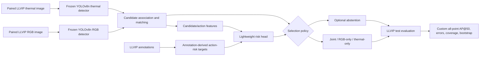

# RAVEN architecture

This diagram is a documentation-level summary of the current LLVIP research workflow. It is intentionally not a claim that every component is trained jointly.

## Component boundaries

- **Inputs:** paired visible-light RGB and thermal images from LLVIP.
- **Detectors:** two frozen COCO-pretrained YOLOv8n detectors; one per modality.
- **Association:** candidate detections are matched to create the candidate/action set.
- **Supervision:** annotation-derived action-risk targets train a lightweight head; this is not end-to-end detector training.
- **Policy:** select joint, RGB-only, or thermal-only output, with optional abstention.
- **Evaluation:** official LLVIP test split, using the notebook's custom all-point AP@50 matching rule plus reported error/coverage and bootstrap analyses.

The clean benchmark reports WBF above RAVEN and the confidence-plus-match ablation marginally above the full model. The architecture diagram does not imply state-of-the-art performance, calibrated risk probabilities, safety validation, or generalization beyond LLVIP.
